# Logbook Eksperimen: Segmentasi Instance pada Lingkungan Indoor Nyata
- **Nama:** Sultan Hamdi Jailani Daulay
- **Mata Kuliah:** Visi Komputer, Evaluasi CPMK 3 (ITS)
- **Variabel Wajib (Digit Terakhir NRP = 3):** Jumlah data latih bertingkat **25% / 50% / 100%** (99 / 198 / 395 gambar, 25% ⊂ 50% ⊂ 100%, `seed = 42`)
- **Dataset Latih:** Panoptic Indoor Segmentation v5 (Roboflow, `panopticindoor/panoptic-indoor-segmentation`), 74 kelas dipakai (9 kelas tidak memiliki contoh di train)
- **Model:** YOLO11m-seg (one-stage CNN), Mask R-CNN R50-FPN v2 (two-stage CNN), Mask2Former Swin-T (transformer)
- **Lingkungan Eksekusi:** Kaggle Notebooks, GPU **Tesla T4 ×2** (2 jalur proses terpisah: GPU0 untuk 100%, GPU1 untuk 25% lalu 50%)
- **Repositori GitHub:** https://github.com/sultanhamdi/computer-vision-instance-segmentation
- **Dataset (Google Drive):** https://drive.google.com/drive/folders/1gD2HryBU5KhfDcX3vlUS0G7QKRW8HC_L?usp=drive_link
- **Proyek Roboflow (`test_own` v1):** https://app.roboflow.com/sultan-hamdi-jailani/cv_instance_seg/1

---

## 1. Hipotesis Bertanggal

| ID | Tanggal | Hipotesis (sebelum hasil akhir) | Hasil Aktual & Status |
|---|---|---|---|
| **H1** | 2026-11-15 (sebelum training pertama) | Penambahan data latih (25% → 50% → 100%) akan menaikkan Mask AP ketiga model. **Model & kelas yang unggul:** Mask2Former Swin-T diperkirakan unggul menyeluruh, khususnya pada kelas struktural besar (`wall-other-merged`, `floor-other-merged`, `table-merged`, `bed`, `window-other`) dan kelas langka (1-29 contoh di train) berkat *global self-attention* dan *pretraining* COCO; sebaliknya, kelas kecil/tipis (`spoon`, `fork`, `bottle`, `cup`) diprediksi lebih sulit bagi CNN (terutama Mask R-CNN dengan grid mask 28×28), namun CNN akan mencatat kenaikan relatif terbesar saat data latih ditambah. | **Terbukti.** Pada `valid` 25%→100%: YOLO +59,5% (0,170→0,271), Mask R-CNN +41,9% (0,159→0,226), Mask2Former +22,7% (0,271→0,332) namun tetap tertinggi di semua fraksi. Pola sama pada `test_own`: YOLO +92,5% (0,109→0,210), Mask R-CNN +67,7% (0,127→0,214), Mask2Former +16,6% (0,259→0,302). Pada kelas langka (1-29 contoh) di `test_own` 100%, Mask2Former unggul jauh (AP **0,406** vs Mask R-CNN 0,229 dan YOLO 0,213), demikian pula pada objek kecil (AP kecil **0,088** vs YOLO 0,028 dan Mask R-CNN 0,024). |
| **H2** | 2026-11-15 (sebelum training pertama) | Akan terjadi penurunan AP (*domain shift*) dari `valid` ke `test` Roboflow dan `test_own` (foto HP sendiri), dengan penurunan paling tajam pada detektor one-stage (YOLO11m-seg) dibanding two-stage dan transformer, terutama pada kelas berlatar/sudut baru (`cup`, `bottle`, `door-stuff`) dan objek bertumpuk. | **Terbukti sebagian (bernuansa).** Penurunan ke `test` tajam pada semua model (sisa AP `test/valid`: YOLO 38,0%, Mask R-CNN 52,4%, Mask2Former 55,9%) karena `test` memiliki gambar >2 MP dan 22,5% instance kelas langka. Ke `test_own`, sisa AP justru lebih tinggi (YOLO 77,5%, Mask2Former 90,8%, Mask R-CNN 94,6%), tetapi YOLO tetap mengalami penurunan relatif terbesar dibanding dua model lain; kelas dengan penurunan terbesar di `test_own` mencakup `cup`, `door-stuff`, dan `bottle`. |
| **H3** | 2026-11-24 | Pada `test_own`, foto kondisi sulit (`oklusi`, `redup`, `silau`, `backlight`) dan kelas tanpa contoh di train (`mouse`, `toothbrush`, `scissors`) akan menurunkan F1 secara drastis; perbaikan praproses (crop/zoom, naikkan resolusi, pencerahan) dapat memulihkan sebagian kegagalan skala/cahaya, tetapi **tidak** bisa memulihkan kelas *unseen*. | **Terbukti.** `oklusi` menjadi kondisi tersulit (AP: YOLO 0,082, Mask R-CNN 0,155, Mask2Former 0,269). Pada `normal_14`, crop/zoom menaikkan deteksi `spoon` (YOLO F1 0,000→0,222; Mask2Former 0,182→0,333) tetapi `toothbrush` tetap 0 di semua model. Pada `redup_07`, pencerahan gamma+CLAHE memulihkan CNN dari F1 0,000→0,400 (YOLO) dan 0,000→0,250 (Mask R-CNN). |

---

## 2. Catatan Proses Kronologis

### Tahap 1: Persiapan Data & Verifikasi Format (2026-11-15)
- Membuat **Notebook 0** (`00_data_prep.ipynb`) untuk mengunduh dataset Roboflow, membersihkan anotasi, membuat subset bertingkat 25%/50%/100% (`seed=42`), dan mengonversi format COCO ke YOLO-seg.
- **Temuan & keputusan:**
  1. Ditemukan 1 gambar `test` dengan 111 instance `book`, sehingga evaluasi GT-vs-GT dengan batas standar COCO `maxDets=100` menghasilkan 0,9994 (bukan 1,0). Verifikasi format di NB 0 menggunakan `maxDets=10000`, sementara evaluasi model tetap memakai standar COCO `maxDets=100`.
  2. Ditemukan 4 gambar `train`/`valid` berukuran fisik 480×640 sedangkan JSON mencatat 640×480 **tanpa tag rotasi EXIF**. Keempat gambar dibuang agar tidak merusak mask training.
  3. Disusun modul bersama `seg_common.py` (identik di NB 1–3) agar ketiga model dievaluasi dengan `pycocotools` yang persis sama (`segm`, area dari mask, `maxDets=100`, `score >= 0,001`).

### Tahap 2: Pilot & Training Penuh 3 Model × 3 Fraksi (2026-11-15)
- Menjalankan pilot 2 epoch (target durasi ~2 jam untuk run 100%) untuk menentukan jumlah epoch final:
  - **YOLO11m-seg:** 150 epoch (pilot ~0,7 mnt/epoch).
  - **Mask R-CNN R50-FPN v2:** 70 epoch (pilot 3,3 mnt / 2 epoch).
  - **Mask2Former Swin-T:** 60 epoch (pilot 4,4 mnt / 2 epoch).
- Menjalankan training penuh 9 run (3 model × 3 fraksi) pada 15 Nov 2026 (07:51–12:22 UTC).
- **Kendala:** Tahap prediksi `test` pada Mask2Former gagal (`returncode=1`, CUDA OOM) karena split `test` memiliki gambar hingga 10,3 MP; upsample 100 query mask sekaligus membutuhkan ±1,3 GB/MP.

### Tahap 3: Perbaikan OOM Mask2Former & Evaluasi Awal (2026-11-17)
- Memperbaiki `instance_inference` di **Notebook 3** agar melakukan upsample mask per potongan `chunk=10` query lalu menyalin mask biner ke CPU (hasil matematis identik, VRAM turun 10×).
- Menjalankan ulang prediksi `valid` dan `test` Mask2Former (17 Nov 2026, 23:10–23:16 UTC) dengan `RUN_TRAINING = False` → sukses tanpa error.
- Membuat **Notebook 4** (`04_perbandingan.ipynb`) untuk perbandingan awal pada `valid` dan `test`.

### Tahap 4: Pengambilan Foto HP, Anotasi Roboflow, & Evaluasi `test_own` (2026-11-24)
- Mengambil 40 foto lingkungan indoor nyata dengan kamera HP sendiri: `normal` (19), `redup` (11), `oklusi` (5), `backlight` (3), `silau` (1), `sudut` (1).
- Mengekstrak metadata EXIF (tanpa lokasi GPS) ke `test own/exif_test_own.csv`; foto asli 12 MP diabaikan Git (`.gitignore`) demi privasi.
- Menganotasi 40 foto di Roboflow (`sultan-hamdi-jailani/cv_instance_seg` v1): **276 poligon, 35 kelas** (semua termasuk 74 kelas dataset; rata-rata 6,9 anotasi/foto; 3 kelas tanpa contoh di train: `mouse`, `toothbrush`, `scissors`). Dokumentasi di `test own/daftar_objek.md`.
- Memperbarui konfigurasi NB 0 untuk mengunduh `test_own` dan menjalankan ulang NB 0 → NB 1–3 (`RUN_TRAINING = False`, prediksi saja) → NB 4.
- **Kendala kecil:** Save & Run All sempat antre (*queued*) di Kaggle; selain itu run pertama NB 4 masih memakai daftar `CONDITIONS` lama sehingga `redup`/`backlight`/`sudut` masuk kelompok `lainnya`.

### Tahap 5: Perbaikan NB 4 & Pembuatan NB 5 Demo + 5 Studi Kasus (2026-11-25)
- Menjalankan ulang NB 4 dengan versi `CONDITIONS` terbaru (`hasil/4/cv-is-perbandingan-final-2.ipynb`, `hasil/4/results-2/`) → keenam kondisi `test_own` terpisah rapi, 0 error.
- Membuat **Notebook 5** (`05_demo_dan_studi_kasus.ipynb`) berisi demo langsung 10 menit (inferensi foto baru, ubah threshold, AP satu kelas, penjelasan baris kode) serta 5 eksperimen pembuktian kegagalan (`oklusi_03`, `normal_14`, `oklusi_04`, `redup_07`, `silau_01`).
- **Kendala kecil:** Error `KeyError: 'id'` di sel konfigurasi NB 5 karena `dataset_info.json` memakai kunci `"coco_id"`. Diperbaiki → run penuh di Kaggle (`hasil/5/cv-is-demo.ipynb`) selesai bersih (0 error).

---

## 3. Rekap Waktu GPU (Kaggle Tesla T4 ×2)

Sumber: log `gpu_time_log.csv` pada output `hasil/1`–`hasil/3` dan `hasil/4/results-2/biaya_vs_hasil.csv`.

| Model | Pilot | Train 25% | Train 50% | Train 100% | Subtotal Train | Predict (valid+test) | Predict Ulang (+`test_own`) | Total Jam-GPU |
|---|---:|---:|---:|---:|---:|---:|---:|---:|
| **YOLO11m-seg** (150 ep) | ~0,02 jam | 0,42 jam | 0,60 jam | 0,91 jam | **1,93 jam** | 0,12 jam | 0,13 jam | **~2,20 jam** |
| **Mask R-CNN R50-FPN v2** (70 ep) | 0,05 jam | 0,59 jam | 0,80 jam | 1,25 jam | **2,65 jam** | 0,14 jam | 0,17 jam | **~3,01 jam** |
| **Mask2Former Swin-T** (60 ep) | 0,07 jam | 0,71 jam | 1,10 jam | 1,84 jam | **3,65 jam** | 0,12* + 0,16 jam | 0,16 jam | **~4,16 jam** |
| **Total** | **0,14 jam** | **1,72 jam** | **2,50 jam** | **4,00 jam** | **8,23 jam** | **0,54 jam** | **0,46 jam** | **~9,37 jam** |

*\*0,12 jam pada 15 Nov gagal OOM sebelum diperbaiki menjadi 0,16 jam pada 17 Nov dengan inferensi per potongan.*
*Notebook 0 dan Notebook 4 dijalankan di CPU; Notebook 5 dijalankan di GPU T4 (~3 menit).*

---

## 4. Riwayat Commit Bertahap

| Hash | Waktu | Ringkasan Commit |
|---|---|---|
| `ecbb4a5` | 2026-11-24 15:11 | Inisialisasi repo: README dan `.gitignore` |
| `8288d59` | 2026-11-24 15:12 | Notebook 0: persiapan data, subset 25/50/100%, konversi COCO→YOLO |
| `b8132c0` | 2026-11-24 15:12 | Notebook 1: YOLO11m-seg, 3 fraksi data, 150 epoch |
| `8298b08` | 2026-11-24 15:12 | Notebook 2: Mask R-CNN R50-FPN v2, 3 fraksi data, 70 epoch |
| `622a8db` | 2026-11-24 15:12 | Notebook 3: Mask2Former Swin-T, 3 fraksi data, 60 epoch |
| `9283c2c` | 2026-11-24 15:12 | Notebook 3: prediksi ulang valid/test dengan inferensi per potongan |
| `649e527` | 2026-11-24 15:12 | Notebook 4: perbandingan model, domain shift, analisis kegagalan (tanpa `test_own`) |
| `6347776` | 2026-11-24 17:32 | `test_own`: 40 foto HP, nama per kondisi, tabel EXIF |
| `8ba8ec7` | 2026-11-24 20:10 | `test_own`: anotasi Roboflow (40 foto, 276 poligon, 35 kelas) dan daftar objek |
| `3002907` | 2026-11-24 20:39 | Konfigurasi `test_own` (Roboflow v1) dan mode prediksi saja untuk Notebook 1–3 |
| `a1f33be` | 2026-11-24 22:11 | Update `.gitignore` |
| `2336d1b` | 2026-11-25 05:28 | Hasil final Notebook 0-3 (`test_own`) dan log training asli (`results.csv`, `gpu_time_log`) |
| `713ab07` | 2026-11-25 05:28 | Hasil final Notebook 4: perbandingan 3 model, domain shift, dan kondisi sulit `test_own` |
| `0bafeef` | 2026-11-25 05:28 | Notebook 5: demo inferensi langsung dan eksperimen 5 studi kasus kegagalan `test_own` |
| `3b1fa66` | 2026-11-25 05:28 | Tambah logbook eksperimen (hipotesis, waktu GPU) dan deklarasi penggunaan AI |
| `d73f79e` | 2026-11-25 05:43 | Update README dengan ringkasan hasil akhir |
| `2bd8c97` | 2026-11-25 05:43 | Update `.gitignore` |
| `d2d54e4` | 2026-11-25 09:44 | Fix minor grammar issue |
| `86b8905` | 2026-11-25 09:53 | Another update on docs (tambah Kasus 5 kesalahan AI) |

---

## 5. Desain Eksperimen, Dataset, dan `test_own`

### 5.1 Dataset Latih & Pembersihan Data
Dataset latih menggunakan **Panoptic Indoor Segmentation v5** (Roboflow, format COCO Segmentation) yang terdiri dari **74 kelas** objek indoor (9 kelas tidak memiliki contoh di `train`: `flower`, `hair drier`, `keyboard`, `mouse`, `scissor`, `scissors`, `teddy bear`, `toaster`, `toothbrush`).

- **Split bawaan:** `train` 395 gambar (4.470 instance), `valid` 164 gambar (2.002 instance), `test` 359 gambar (5.344 instance).
- **Pembersihan data (`00_data_prep.ipynb`):** 4 gambar pada `train`/`valid` dibuang karena ukuran file fisik (480×640) tidak cocok dengan anotasi JSON (640×480) tanpa tag rotasi EXIF.
- **Variabel wajib NRP (digit terakhir = 3):** subset latih bertingkat `25% ⊂ 50% ⊂ 100%` (`seed = 42`), yaitu **99 / 198 / 395 gambar**, sehingga perubahan performa murni berasal dari tambahan data.

### 5.2 Test Set Foto HP Sendiri (`test_own`)
Sebagai uji *domain shift* di lingkungan indoor nyata, diambil **40 foto** menggunakan kamera HP pribadi dengan 6 kategori kondisi: `normal` (19), `redup` (11), `oklusi` (5), `backlight` (3), `silau` (1), dan `sudut` (1), sehingga terdapat **21 foto kondisi sulit** (memenuhi syarat minimal ≥10). Banyak foto dibuat **berpasangan** pada pemandangan yang sama (normal vs redup/backlight/silau) untuk membandingkan efek pencahayaan secara adil.

- **Anotasi Roboflow ([`sultan-hamdi-jailani/cv_instance_seg` v1](https://app.roboflow.com/sultan-hamdi-jailani/cv_instance_seg/1)):** 276 poligon, 35 kelas (seluruhnya bagian dari 74 kelas dataset, termasuk 3 kelas *unseen* di train: `mouse`, `toothbrush`, `scissors`), resolusi 639×480.
- **Bukti EXIF & daftar objek:** tersimpan lengkap di [`test own/exif_test_own.csv`](test%20own/exif_test_own.csv) (tanpa lokasi GPS demi privasi) dan [`test own/daftar_objek.md`](test%20own/daftar_objek.md).

**Contoh Metadata EXIF Foto Asli `test_own` (Perwakilan 6 Kondisi, Tanpa GPS):**

| File Baru | File Asli | Kondisi | Kamera | Waktu Ambil | Ukuran | ISO | Eksposur | f-number | Fokus (mm) |
|---|---|---|---|---|---|---:|---:|---:|---:|
| `normal_01.jpg` | `IMG_20261124_154958.jpg` | `normal` | Xiaomi 23049PCD8G | 2026:11:24 15:49:58 | 4624×3472 | 695 | 1/33 | 1,8 | 4,68 |
| `redup_07.jpg` | `IMG_20261124_165717.jpg` | `redup` | Xiaomi 23049PCD8G | 2026:11:24 16:57:17 | 4624×3472 | 9600 | 1/6 | 1,8 | 4,68 |
| `oklusi_03.jpg` | `IMG_20261124_171633.jpg` | `oklusi` | Xiaomi 23049PCD8G | 2026:11:24 17:16:33 | 4624×3472 | 1029 | 1/25 | 1,8 | 4,68 |
| `backlight_01.jpg` | `IMG_20261124_165026.jpg` | `backlight` | Xiaomi 23049PCD8G | 2026:11:24 16:50:26 | 4624×3472 | 3502 | 1/20 | 1,8 | 4,68 |
| `silau_01.jpg` | `IMG_20261124_165312.jpg` | `silau` | Xiaomi 23049PCD8G | 2026:11:24 16:53:13 | 4624×3472 | 570 | 1/25 | 1,8 | 4,68 |
| `sudut_01.jpg` | `IMG_20261124_171825.jpg` | `sudut` | Xiaomi 23049PCD8G | 2026:11:24 17:18:25 | 4624×3472 | 901 | 1/25 | 1,8 | 4,68 |

*Terlihat jelas pada EXIF bahwa kondisi `redup` memaksa kamera menaikkan ISO hingga 9600 dengan kecepatan rana lambat (1/6 detik), konsisten dengan penurunan ketajaman dan kecerahan pada analisis.*

**Bukti Proses Anotasi Manual Poligon di Roboflow:**

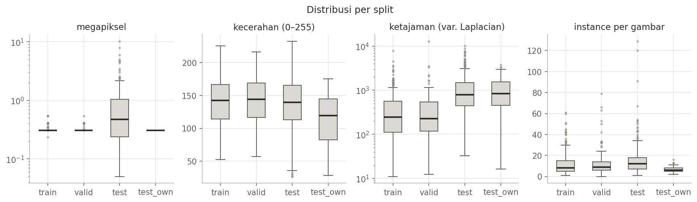

### 5.3 Arsitektur 3 Model & Evaluasi Seragam
Ketiga model mewakili 3 paradigma dari 2 keluarga arsitektur (one-stage CNN, two-stage CNN, dan Transformer), dipilih agar kapasitasnya seimbang terhadap ukuran data latih (99-395 gambar) serta batas VRAM 16 GB GPU Kaggle T4:

| Model | Keluarga | Mekanisme Utama | Alasan Pemilihan Varian |
|---|---|---|---|
| **YOLO11m-seg** | One-stage CNN (anchor-free) | Koefisien mask × 32 proto-mask (160×160), `retina_masks=True`, deduplikasi NMS | Varian `m` (medium) seimbang untuk 74 kelas (tidak mudah *underfit* seperti `n`/`s` dan lebih hemat/stabil di 25% data dibanding `l`/`x`). |
| **Mask R-CNN R50-FPN v2** | Two-stage CNN | RPN + `RoIAlign` 14×14 → `MaskRCNNPredictor` 28×28, deduplikasi NMS | Versi `v2` memakai FPN modern (*BatchNorm*) + pretraining COCO lebih kuat dari v1; ResNet-50 pas di VRAM T4 dan tidak seberat ResNet-101. |
| **Mask2Former Swin-T** | Transformer | 100 *object queries* + *masked-attention* global + *Hungarian matching* (tanpa NMS) | Varian `Swin-Tiny` paling sesuai anggaran VRAM T4 (~1,84 jam untuk 100% data) dan paling stabil dari *overfitting* pada data kecil dibanding `Swin-B`/`Swin-L`. |

Seluruh model dievaluasi dengan modul **`seg_common.py`** yang identik di Notebook 1-3 menggunakan `pycocotools`: **Mask AP = `mAP@[.50:.95]` COCO**, area dihitung dari mask, `maxDets = 100`, dan `score >= 0,001`.

---

## 6. Hasil Eksperimen & Analisis Kuantitatif

### 6.1 Pengaruh Jumlah Data Latih (25% / 50% / 100%)

**Tabel Mask AP (`mAP@[.50:.95]`):**

| Model | `valid` (25 / 50 / 100%) | `test` (25 / 50 / 100%) | `test_own` (25 / 50 / 100%) | Kenaikan 25→100% (`valid` / `test_own`) |
|---|---:|---:|---:|---:|
| **YOLO11m-seg** | 0,170 / 0,196 / 0,271 | 0,097 / 0,102 / 0,103 | 0,109 / 0,146 / **0,210** | **+59,5%** / **+92,5%** |
| **Mask R-CNN R50-FPN v2** | 0,159 / 0,181 / 0,226 | 0,086 / 0,102 / 0,118 | 0,127 / 0,149 / **0,214** | +41,9% / +67,7% |
| **Mask2Former Swin-T** | **0,271 / 0,282 / 0,332** | **0,151 / 0,186 / 0,186** | **0,259 / 0,285 / 0,302** | +22,7% / +16,6% |

**Tabel Mask AP50 (`mAP@0.50`):**

| Model | `valid` (25 / 50 / 100%) | `test` (25 / 50 / 100%) | `test_own` (25 / 50 / 100%) |
|---|---:|---:|---:|
| **YOLO11m-seg** | 0,244 / 0,274 / 0,360 | 0,147 / 0,153 / 0,156 | 0,169 / 0,224 / 0,300 |
| **Mask R-CNN R50-FPN v2** | 0,250 / 0,278 / 0,322 | 0,140 / 0,166 / 0,182 | 0,232 / 0,245 / 0,318 |
| **Mask2Former Swin-T** | **0,366 / 0,390 / 0,433** | **0,224 / 0,261 / 0,260** | **0,377 / 0,378 / 0,398** |

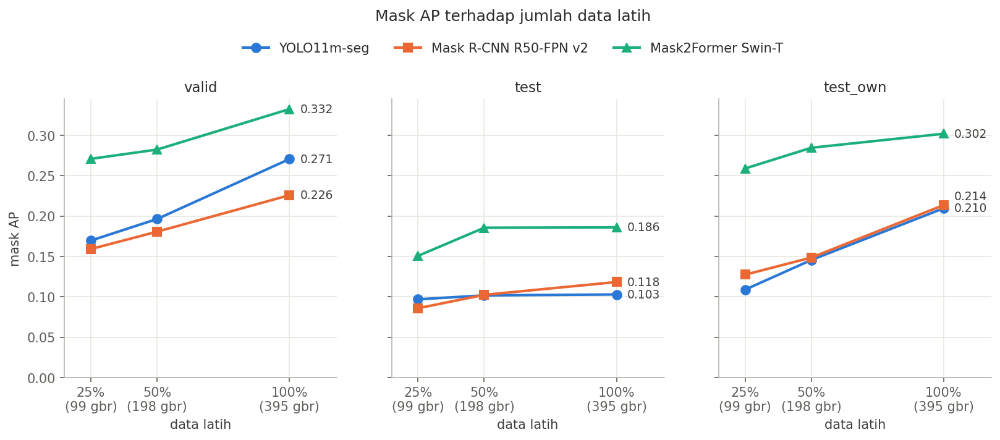

- **Mask2Former Swin-T** unggul konsisten di seluruh fraksi dan split; bahkan pada 25% data (0,259 di `test_own`), performanya sudah melampaui kedua model CNN pada 100% data (0,210 dan 0,214).
- Kedua arsitektur **CNN** jauh lebih sensitif terhadap jumlah data (YOLO11m-seg naik +92,5% dan Mask R-CNN naik +67,7% pada `test_own` dari 25% ke 100%).

### 6.2 Kurva Belajar, Ketajaman Mask, dan Ukuran Objek

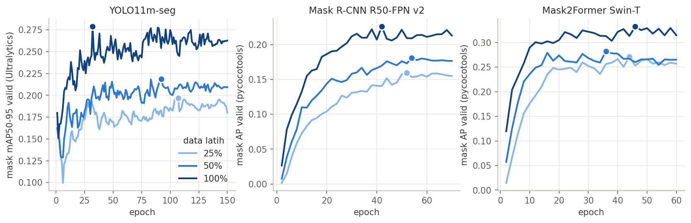

| Model (fraksi 100%, `test_own`) | AP@.50 | AP@.75 | AP@.90 | Rasio `AP75/AP50` | AP Kecil | AP Sedang | AP Besar | Inferensi (`test`) |
|---|---:|---:|---:|---:|---:|---:|---:|---:|
| **YOLO11m-seg** | 0,300 | 0,223 | 0,119 | 0,741 | 0,028 | 0,179 | 0,301 | **166,7 ms** |
| **Mask R-CNN R50-FPN v2** | 0,318 | 0,227 | 0,127 | 0,715 | 0,024 | 0,150 | 0,328 | 208,0 ms |
| **Mask2Former Swin-T** | **0,398** | **0,335** | **0,184** | **0,842** | **0,088** | **0,193** | **0,434** | 196,2 ms |

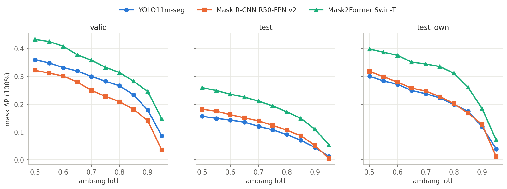

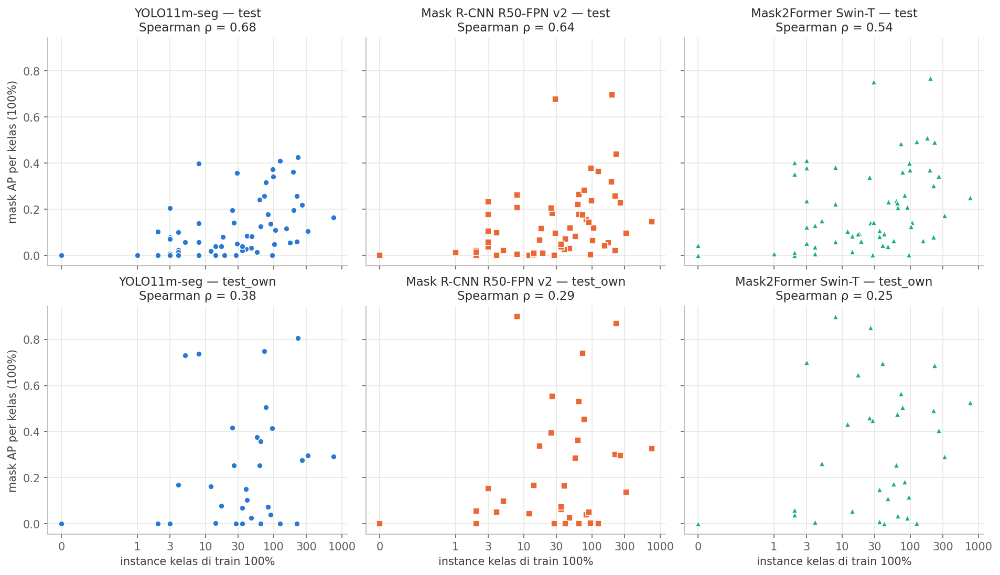

### 6.3 Domain Shift (`valid` → `test` → `test_own`) & Jenis Kesalahan

| Model (100%) | AP `valid` | AP `test` | AP `test_own` | Sisa `test/valid` | Sisa `test_own/valid` | Presisi (`test_own`) | Recall (`test_own`) | F1 (`test_own`) | Duplikat (`test_own`) |
|---|---:|---:|---:|---:|---:|---:|---:|---:|---:|
| **YOLO11m-seg** | 0,271 | 0,103 | 0,210 | 38,0% | 77,5% | 0,393 | 0,344 | 0,367 | 6 (4,1%) |
| **Mask R-CNN R50-FPN v2** | 0,226 | 0,118 | 0,214 | 52,4% | **94,6%** | 0,389 | 0,380 | 0,385 | 2 (1,2%) |
| **Mask2Former Swin-T** | **0,332** | **0,186** | **0,302** | **55,9%** | 90,8% | **0,530** | **0,449** | **0,486** | **0 (0,0%)** |

- Penurunan `valid → test` lebih tajam daripada `valid → test_own` karena split `test` Roboflow sangat padat (14,9 inst/gambar, 40% objek <1% luas gambar, 5,3% foto >2 MP hingga 10,3 MP, 22,5% kelas langka).
- Pada `test_own`, kesalahan dominan ketiga model adalah **latar (background FP)** (40,8%-50,9% dari FP) dan **salah kelas** (23,6%-31,5%). Mask2Former mencatat **0 duplikat** berkat *Hungarian matching*.

### 6.4 Evaluasi Kondisi Sulit pada `test_own`

| Kondisi | Foto | Instance | YOLO11m-seg (AP / F1) | Mask R-CNN (AP / F1) | Mask2Former (AP / F1) |
|---|---:|---:|---:|---:|---:|
| `normal` | 19 | 130 | 0,214 / 0,367 | 0,247 / 0,366 | 0,367 / 0,497 |
| `redup` | 11 | 74 | 0,364 / 0,387 | 0,328 / 0,360 | 0,464 / 0,537 |
| `oklusi` | 5 | 36 | **0,082 / 0,076** | **0,155 / 0,168** | **0,269 / 0,245** |
| `backlight` | 3 | 26 | 0,457 / 0,481 | 0,394 / 0,541 | 0,346 / 0,414 |
| `silau` | 1 | 7 | 0,123 / 0,267 | 0,386 / 0,462 | 0,298 / 0,600 |
| `sudut` | 1 | 3 | 0,467 / 0,286 | 0,567 / 0,667 | 0,617 / 0,667 |

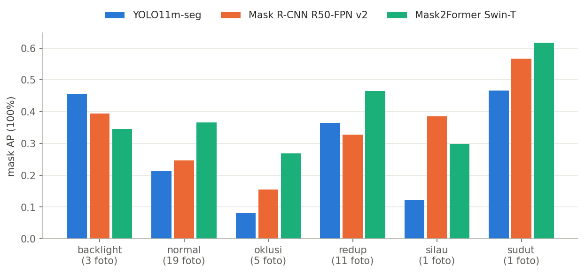

- **`oklusi`** adalah kondisi tersulit bagi ketiga model. Nilai AP `redup` dan `backlight` yang tampak tinggi dipengaruhi komposisi objek struktural besar (`wall`, `floor`, `door`, `window`), sedangkan kelompok `normal` banyak berisi objek sangat kecil (`spoon`, `fork`) dan kelas *unseen* (`toothbrush`, `mouse`, `scissors`).

**Galeri 4 Foto Terburuk `test_own` (F1 rata-rata terendah, Notebook 4):**

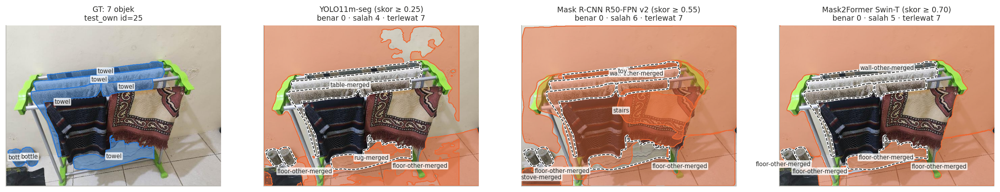

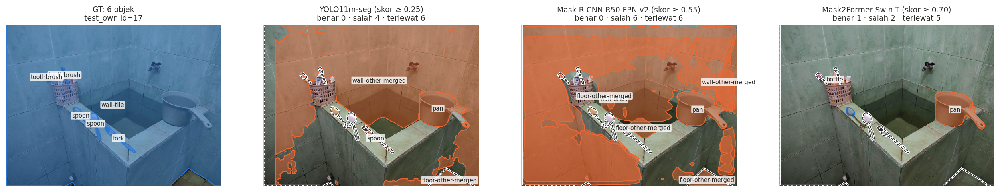

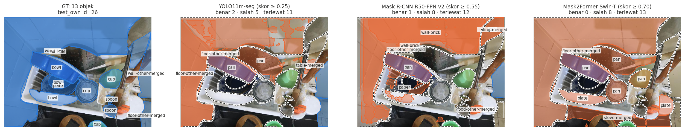

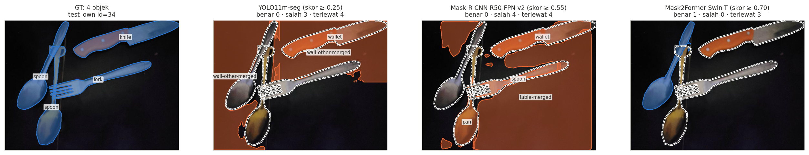

---

## 7. Lima Studi Kasus Kegagalan (`test_own`) & Eksperimen Pembuktian Kecil

Seluruh eksperimen pembuktian dijalankan langsung pada bobot 100% (`conf = 0,25`) di [`notebooks/05_demo_dan_studi_kasus.ipynb`](notebooks/05_demo_dan_studi_kasus.ipynb) (output lengkap: [`hasil/5/cv-is-demo.ipynb`](hasil/5/cv-is-demo.ipynb)).

### Kasus 1: Oklusi Berat & Kelas Langka (`oklusi_03`)
- **Gejala & mekanisme:** 5 `towel` (14 contoh di train) bertumpuk + 2 `bottle` kecil (0,6% luas). Dugaan awal: proposal berhimpitan tertekan NMS atau ukuran objek terlalu kecil.
- **Eksperimen:** (1a) Turunkan `conf` `0,25 → 0,05` dan longgarkan NMS IoU YOLO `0,7 → 0,9`; (1b) Crop/Zoom pada area objek.
- **Hasil:** TP tidak bertambah sama sekali pada kedua eksperimen (YOLO F1 `0,000 → 0,000`, Mask R-CNN `0,100 → 0,047` / `0,080` dengan FP melonjak 12→35, Mask2Former `0,000 → 0,000`).
- **Pembuktian:** Kegagalan bukan disebabkan oleh threshold/NMS atau skala, melainkan murni karena representasi kelas langka `towel` yang terlipat/teroklusi berada di luar distribusi latih.

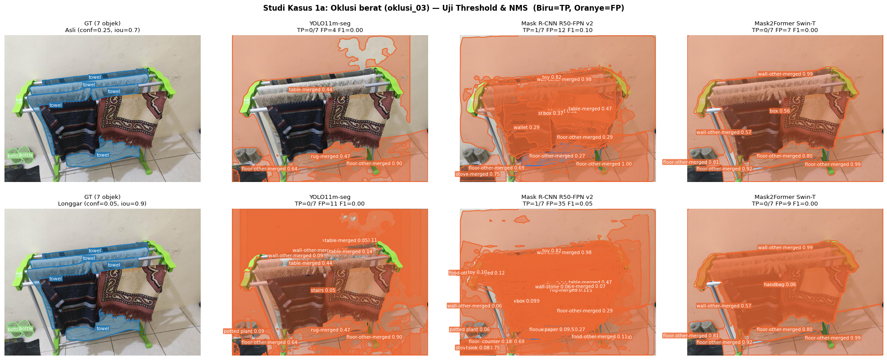

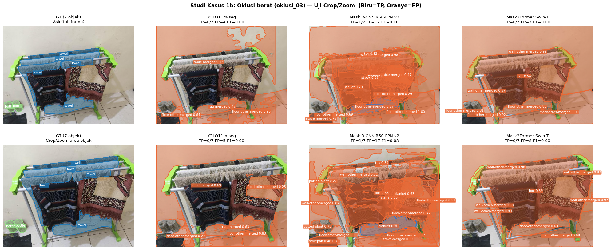

### Kasus 2: Kelas *Unseen* vs Objek Sangat Kecil (`normal_14`)
- **Gejala & mekanisme:** Memuat 2 `toothbrush` (**0 contoh di train**), 2 `spoon` (0,2-0,3% luas), 1 `fork` (4 contoh di train, 0,3% luas), dan latar `wall-tile`. Classifier *closed-set* mustahil mendeteksi `toothbrush`, sedangkan `spoon`/`fork` tergerus stride downsampling.
- **Eksperimen:** Crop/Zoom ketat khusus pada area objek-objek kecil.
- **Hasil:** **YOLO F1 `0,000 → 0,222`** (mulai mendeteksi 2 `spoon`), **Mask2Former F1 `0,182 → 0,333`** (TP 1→2), Mask R-CNN `0,125 → 0,000`, sementara **`toothbrush` tetap 0 deteksi di ketiga model**.
- **Pembuktian:** Memisahkan secara tegas kegagalan resolusi/skala (`spoon` pulih saat di-zoom) vs kegagalan *closed-set* (`toothbrush` tetap 0 meski sudah diperbesar).

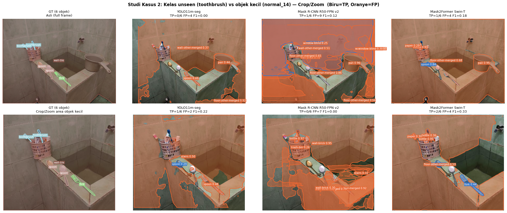

### Kasus 3: Adegan Padat 13 Objek Bertumpuk (`oklusi_04`)
- **Gejala & mekanisme:** 13 objek berhimpitan di rak (`bowl`, `cup`, `plate`, `spoon`, `wall-tile`). Pada input 640 px, fitur wadah yang saling menumpuk mudah bercampur di batas tepi pada **proto-mask 160×160 YOLO11m-seg**, **grid mask 28×28 per RoI pada Mask R-CNN**, dan feature map P3/P4.
- **Eksperimen:** Naikkan resolusi inferensi dari `640 → 960`.
- **Hasil:** **Ketiga model serempak naik F1**: YOLO `0,200 → 0,235` (FP turun 5→2), Mask R-CNN `0,062 → 0,100` (TP 1→2), Mask2Former `0,000 → 0,133` (TP 0→2).
- **Pembuktian:** Resolusi input 640 px membatasi pemisahan objek padat; peningkatan resolusi langsung meningkatkan deteksi.

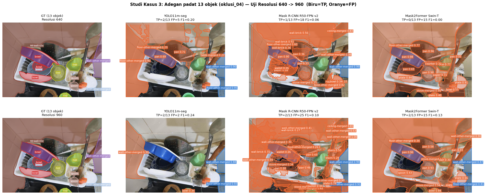

### Kasus 4: Cahaya Redup pada Objek Kecil (`redup_07` vs Pasangan `oklusi_01`)
- **Gejala & mekanisme:** Pada `redup_07` (`knife`, `spoon`×2, `fork`), kontras tepi yang lemah membuat YOLO dan Mask R-CNN jatuh ke F1 `0,000`, sementara Mask2Former tetap mampu mendeteksi (F1 `0,500` pada `conf=0,25`) berkat konteks global.
- **Eksperimen:** Pencerahan `gamma = 0,55` + CLAHE pada kanal L (ruang LAB), dibandingkan juga dengan pasangan cahaya normal `oklusi_01`.
- **Hasil:** **YOLO melompat `0,000 → 0,400`** (TP 0→2) dan **Mask R-CNN melompat `0,000 → 0,250`** (TP 0→2); Mask2Former mempertahankan TP = 2 (F1 `0,500 → 0,400`).
- **Pembuktian:** Mengonfirmasi bahwa backbone CNN sangat bergantung pada kekuatan gradien tepi lokal (langsung pulih setelah pencerahan), sedangkan Transformer jauh lebih tahan kondisi redup.

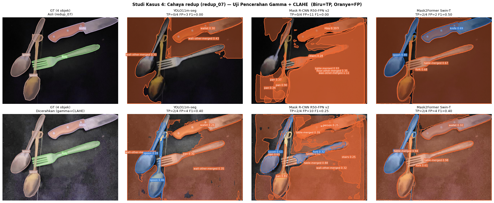

### Kasus 5: Silau / Pantulan Cahaya Kuat (`silau_01` vs Pasangan `normal_10`)
- **Gejala & mekanisme:** Pantulan lampu menciptakan piksel jenuh (*clipped highlights*) di sekitar laptop dan meja; detektor one-stage (YOLO) paling terdampak (F1 `0,267` vs Mask R-CNN `0,444` dan Mask2Former `0,429`).
- **Eksperimen:** Kompresi highlight `gamma = 1,35` + CLAHE lokal.
- **Hasil:** **Mask2Former naik `0,429 → 0,462`** (FP turun 4→3), tetapi **YOLO turun `0,267 → 0,143`** dan Mask R-CNN `0,444 → 0,429`.
- **Pembuktian:** Informasi piksel yang sudah jenuh putih hilang permanen; pascaproses sederhana tidak dapat memulihkannya dan justru menggeser distribusi kontras lokal yang sensitif bagi CNN.

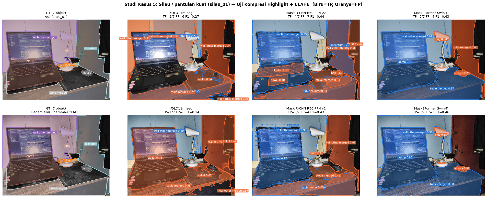

### Bukti Demo Inferensi & Perubahan Threshold (Notebook 5)

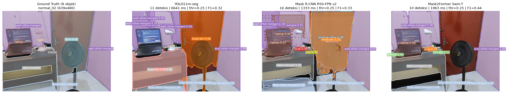

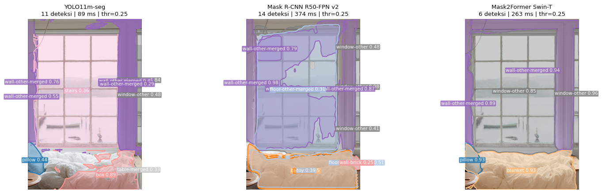

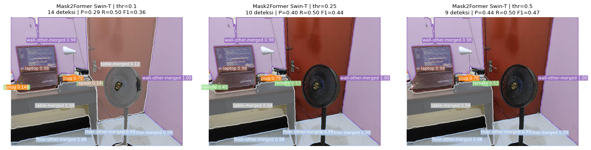

---

## 8. Kesimpulan & Keterbatasan

1. **Performa terbaik:** **Mask2Former Swin-T** unggul konsisten di semua fraksi data (25%/50%/100%) dan seluruh split (`valid` 0,332; `test` 0,186; `test_own` 0,302), dengan tepi mask paling tajam (`AP75/AP50 = 0,842`), AP objek kecil tertinggi (0,088), 0 deteksi duplikat, serta ketahanan terbaik pada oklusi dan cahaya redup, dengan biaya komputasi tertinggi (3,65 jam-GPU training).
2. **Efek jumlah data latih (variabel NRP):** Penambahan data 25% → 50% → 100% menaikkan AP semua model, dengan kenaikan relatif paling besar pada CNN (**YOLO11m-seg +92,5%**, **Mask R-CNN +67,7%** di `test_own`), sementara **YOLO11m-seg** tetap unggul pada efisiensi waktu latih (1,93 jam-GPU) dan kecepatan inferensi (166,7 ms/gambar).
3. **Keterbatasan utama:** Model bersifat *closed-set* (9 kelas tanpa contoh di train pasti AP = 0), ukuran data latih kecil (395 gambar) dengan distribusi kelas timpang (*long-tail*), dan CNN sensitif terhadap cahaya redup serta oklusi berat.

---

## 9. Lampiran & Tautan Bukti Proses

### Tautan Eksternal Utama
- **Repositori GitHub:** https://github.com/sultanhamdi/computer-vision-instance-segmentation
- **Dataset (Google Drive):** https://drive.google.com/drive/folders/1gD2HryBU5KhfDcX3vlUS0G7QKRW8HC_L?usp=drive_link
- **Roboflow (`test_own` v1):** https://app.roboflow.com/sultan-hamdi-jailani/cv_instance_seg/1

### A. Kode Sumber Notebook (`notebooks/`)
- [`notebooks/00_data_prep.ipynb`](notebooks/00_data_prep.ipynb) (persiapan data, subset 25/50/100%, konversi COCO→YOLO, `test_own`)
- [`notebooks/01_yolo11_seg.ipynb`](notebooks/01_yolo11_seg.ipynb) (training & evaluasi YOLO11m-seg)
- [`notebooks/02_mask_rcnn.ipynb`](notebooks/02_mask_rcnn.ipynb) (training & evaluasi Mask R-CNN R50-FPN v2)
- [`notebooks/03_mask2former.ipynb`](notebooks/03_mask2former.ipynb) (training & evaluasi Mask2Former Swin-T)
- [`notebooks/04_perbandingan.ipynb`](notebooks/04_perbandingan.ipynb) (perbandingan 3 model, domain shift, kondisi sulit, galeri kegagalan)
- [`notebooks/05_demo_dan_studi_kasus.ipynb`](notebooks/05_demo_dan_studi_kasus.ipynb) (inferensi interaktif & 5 studi kasus kegagalan)

### B. Salinan Notebook Hasil Eksekusi Kaggle (`hasil/`)
- Notebook 0: [`hasil/0/cv-is-data-prep-final.ipynb`](hasil/0/cv-is-data-prep-final.ipynb)
- Notebook 1: [`hasil/1/cv-is-yolo11-seg.ipynb`](hasil/1/cv-is-yolo11-seg.ipynb) (training) | [`hasil/1/cv-is-yolo11-seg-final.ipynb`](hasil/1/cv-is-yolo11-seg-final.ipynb) (`test_own`)
- Notebook 2: [`hasil/2/cv-is-mask-rcnn_pilot.ipynb`](hasil/2/cv-is-mask-rcnn_pilot.ipynb) (pilot) | [`hasil/2/cv-is-mask-rcnn.ipynb`](hasil/2/cv-is-mask-rcnn.ipynb) (training) | [`hasil/2/cv-is-mask-rcnn-final.ipynb`](hasil/2/cv-is-mask-rcnn-final.ipynb) (`test_own`)
- Notebook 3: [`hasil/3/cv-is-mask2former_pilot.ipynb`](hasil/3/cv-is-mask2former_pilot.ipynb) (pilot) | [`hasil/3/cv-is-mask2former.ipynb`](hasil/3/cv-is-mask2former.ipynb) (training) | [`hasil/3/cv-is-mask2former (1).ipynb`](hasil/3/cv-is-mask2former%20%281%29.ipynb) (fix OOM) | [`hasil/3/cv-is-mask2former-final.ipynb`](hasil/3/cv-is-mask2former-final.ipynb) (`test_own`)
- Notebook 4: [`hasil/4/cv-is-perbandingan-final-2.ipynb`](hasil/4/cv-is-perbandingan-final-2.ipynb) (evaluasi final 6 kondisi `test_own`)
- Notebook 5: [`hasil/5/cv-is-demo.ipynb`](hasil/5/cv-is-demo.ipynb) | [`hasil/5/cv-is-demo_final.ipynb`](hasil/5/cv-is-demo_final.ipynb) (final: +uji foto URL eksternal & 5 eksperimen studi kasus)

### C. Log Training Asli (`results.csv` & `gpu_time_log.csv`)
- **YOLO11m-seg:** [`025/results.csv`](hasil/1/runs/yolo11m_seg_025/results.csv) | [`050/results.csv`](hasil/1/runs/yolo11m_seg_050/results.csv) | [`100/results.csv`](hasil/1/runs/yolo11m_seg_100/results.csv) | [`gpu_time_log.csv`](hasil/1/gpu_time_log.csv)
- **Mask R-CNN R50-FPN v2:** [`025/results.csv`](hasil/2/runs/mask_rcnn_r50_025/results.csv) | [`050/results.csv`](hasil/2/runs/mask_rcnn_r50_050/results.csv) | [`100/results.csv`](hasil/2/runs/mask_rcnn_r50_100/results.csv) | [`gpu_time_log.csv`](hasil/2/gpu_time_log.csv)
- **Mask2Former Swin-T:** [`025/results.csv`](hasil/3/runs/mask2former_swin_t_025/results.csv) | [`050/results.csv`](hasil/3/runs/mask2former_swin_t_050/results.csv) | [`100/results.csv`](hasil/3/runs/mask2former_swin_t_100/results.csv) | [`gpu_time_log.csv`](hasil/3/gpu_time_log.csv)

### D. Tabel CSV Ringkasan, Bukti `test_own`, & Dokumen Lain
- Tabel hasil NB 4: [`tabel_segm_AP.csv`](hasil/4/results-2/tabel_segm_AP.csv), [`tabel_segm_AP50.csv`](hasil/4/results-2/tabel_segm_AP50.csv), [`domain_shift.csv`](hasil/4/results-2/domain_shift.csv), [`test_own_per_kondisi.csv`](hasil/4/results-2/test_own_per_kondisi.csv), [`jenis_kesalahan.csv`](hasil/4/results-2/jenis_kesalahan.csv), [`biaya_vs_hasil.csv`](hasil/4/results-2/biaya_vs_hasil.csv), [`statistik_split.csv`](hasil/4/results-2/statistik_split.csv)
- Bukti `test_own`: [`test own/exif_test_own.csv`](test%20own/exif_test_own.csv), [`test own/daftar_objek.md`](test%20own/daftar_objek.md), [`test own/test/_annotations.coco.json`](test%20own/test/_annotations.coco.json), [`docs/bukti_anotasi_manual/Screenshot 2026-11-24 181114.png`](docs/bukti_anotasi_manual/Screenshot%202026-11-24%20181114.png), [`docs/bukti_anotasi_manual/Screenshot 2026-11-24 191344.png`](docs/bukti_anotasi_manual/Screenshot%202026-11-24%20191344.png)
- Dokumen pendukung: [`DEKLARASI_AI.md`](DEKLARASI_AI.md), [`README.md`](README.md)

---

## 10. Deklarasi Penggunaan AI

### 10.1 Pernyataan Transparansi

Dalam pengerjaan tugas Evaluasi CPMK 3 (Segmentasi Instance pada Lingkungan Indoor Nyata), asisten AI berbasis LLM (**Claude Code / Antigravity**) digunakan sebagai alat bantu pemrograman, debugging, dan penyusunan kerangka analisis. Seluruh keputusan eksperimen, pengambilan dan anotasi dataset uji sendiri (`test_own`), eksekusi di Kaggle, verifikasi angka, serta pertanggungjawaban isi laporan dilakukan secara mandiri oleh pemilik tugas.

#### Pembagian Pekerjaan
- **Dikerjakan secara mandiri tanpa AI:**
  - Pengambilan 40 foto indoor nyata menggunakan kamera HP pribadi dengan variasi kondisi (`normal`, `redup`, `oklusi`, `backlight`, `silau`, `sudut`).
  - Anotasi manual 276 poligon (35 kelas) di Roboflow serta ekstraksi bukti EXIF.
  - Eksekusi seluruh notebook di Kaggle (pilot, training 9 model, prediksi ulang, perbandingan, dan demo).
  - Verifikasi visual mask, pemeriksaan konsistensi hasil, dan penarikan kesimpulan akhir.
- **Dibantu AI (dengan verifikasi & revisi):**
  - Penulisan kerangka kode persiapan data (`00_data_prep.ipynb`), modul evaluasi seragam `seg_common.py`, dan skrip training/prediksi 3 arsitektur (`01`-`03`).
  - Pembuatan visualisasi analisis perbandingan, domain shift, dan galeri kegagalan (`04_perbandingan.ipynb`).
  - Pembuatan notebook demo langsung & 5 eksperimen pembuktian studi kasus (`05_demo_dan_studi_kasus.ipynb`).
  - Penyusunan draf logbook dan kerangka laporan berdasarkan angka riil dari output CSV/notebook.

### 10.2 Ringkasan Prompt Utama yang Digunakan

1. **Perancangan pipeline & persiapan data:**
   *"Buat pipeline notebook Kaggle (GPU T4×2) untuk membandingkan YOLO11m-seg, Mask R-CNN R50-FPN v2, dan Mask2Former Swin-T pada dataset Panoptic Indoor Segmentation v5 dengan subset bertingkat 25%/50%/100% dan evaluasi pycocotools yang seragam untuk semua model."*
2. **Debugging & perbaikan memori:**
   *"Prediksi split test pada Mask2Former gagal OOM di GPU T4 karena ada gambar beresolusi ~10 MP. Perbaiki fungsi inferensi agar hemat VRAM tanpa mengubah hasil numerik."*
3. **Evaluasi `test_own` & analisis kegagalan:**
   *"Integrasikan test set foto HP sendiri (`test_own`, 40 foto dari Roboflow) ke Notebook 0-4, evaluasi ulang semua model dengan mode `RUN_TRAINING = False`, dan periksa kondisi sulit per awalan nama file."*
4. **Demo langsung & eksperimen 5 studi kasus:**
   *"Buat Notebook 5 untuk demo 10 menit (inferensi foto baru, ubah threshold, hitung AP satu kelas) dan 5 eksperimen pembuktian kecil pada foto kegagalan `test_own` (crop/zoom, ubah resolusi, pencerahan gamma+CLAHE, redam silau)."*

### 10.3 Kasus Konkret Saran / Kode AI yang Salah (Beserta Perbaikannya)

Sesuai ketentuan tugas, berikut lima kasus nyata di mana saran atau kode AI terbukti salah saat diverifikasi terhadap data/eksekusi di Kaggle:

#### Kasus 1: Diagnosis salah "tag rotasi EXIF" pada 4 gambar `train`/`valid`
- **Saran AI yang salah:** Saat ditemukan 4 gambar yang ukuran filenya 480×640 sedangkan dimensi di JSON 640×480, AI langsung mendiagnosis penyebabnya adalah tag rotasi EXIF dan mengusulkan perbaikan dengan `ImageOps.exif_transpose`.
- **Fakta setelah dicek:** Keempat gambar tersebut **tidak memiliki tag EXIF sama sekali**; dimensi di file gambar memang tidak cocok dengan anotasi JSON.
- **Perbaikan:** Keempat gambar bermasalah tersebut dibuang secara eksplisit di Notebook 0 agar tidak merusak poligon saat training.

#### Kasus 2: Kode inferensi Mask2Former buatan AI memicu CUDA OOM di GPU T4
- **Kode AI yang salah:** Implementasi awal `instance_inference` di Notebook 3 melakukan `F.interpolate` terhadap seluruh 100 query mask sekaligus ke resolusi asli gambar di GPU. Pada split `test` yang memiliki gambar ±10 MP, operasi tersebut membutuhkan ±1,3 GB VRAM per megapiksel sehingga memicu OOM (`returncode=1` pada run 15 Nov 2026).
- **Perbaikan:** Mengubah `instance_inference` untuk melakukan upsampling per potongan `chunk=10` query lalu menyalin mask biner ke CPU. Pemakaian VRAM turun ~10× dengan hasil AP yang identik secara matematis (run ulang 17 Nov 2026 berhasil, `returncode=0`).

#### Kasus 3: Kesimpulan awal AI yang keliru soal "AP `test` datar adalah sifat data"
- **Analisis AI yang salah:** Setelah melihat Mask AP `test` YOLO11m-seg hampir tidak naik saat data ditambah (0,097 → 0,102 → 0,103), AI menyimpulkan bahwa datarnya kurva merupakan sifat inheren split `test` yang tidak bisa diperbaiki oleh penambahan data.
- **Fakta setelah semua model selesai:** Mask R-CNN (`0,086 → 0,102 → 0,118`, naik +37,8%) dan Mask2Former (`0,151 → 0,186 → 0,186`, naik +23,4%) ternyata **naik nyata** di split `test` yang sama. Jadi kesimpulan AI terbantahkan; fenomena datar pada `test` lebih spesifik pada keterbatasan generalisasi one-stage YOLO11m-seg terhadap domain shift `test`.

#### Kasus 4: Asumsi nama kunci JSON `"id"` pada Notebook 5 (`KeyError`)
- **Kode AI yang salah:** Saat membuat `05_demo_dan_studi_kasus.ipynb`, AI menuliskan `CAT_NAME = {c["id"]: c["name"] for c in CLASSES}` tanpa memeriksa skema `dataset_info.json` yang dihasilkan Notebook 0.
- **Fakta saat dijalankan di Kaggle:** Sel konfigurasi langsung gagal dengan `KeyError: 'id'` karena `dataset_info.json` menyimpan kunci `"coco_id"` (bukan `"id"`).
- **Perbaikan:** Mengganti `c["id"]` menjadi `c["coco_id"]` di sel 3 Notebook 5; setelah diperbaiki, seluruh 28 sel Notebook 5 berjalan bersih dengan 0 error.

#### Kasus 5: Daftar objek hasil inspeksi AI pada foto `raw` `test_own` tidak akurat
- **Saran AI yang salah:** Saat diminta mendaftar objek apa saja yang muncul pada foto-foto `raw` `test_own` sebagai acuan awal sebelum anotasi, AI menghasilkan daftar yang tidak sesuai kondisi gambar sebenarnya: beberapa objek yang jelas ada di foto terlewat (tidak tercantum di daftar), sementara beberapa label lain justru dicantumkan padahal objeknya tidak ada di foto (*hallucination*).
- **Fakta setelah dicek:** Ketidaksesuaian ditemukan langsung saat pengecekan visual manual di editor anotasi Roboflow.
- **Perbaikan:** Tidak mengandalkan daftar AI; seluruh 40 foto diperiksa dan dianotasi manual langsung di Roboflow (276 poligon, 35 kelas), lalu `test own/daftar_objek.md` disusun ulang dari file anotasi final `_annotations.coco.json`.
