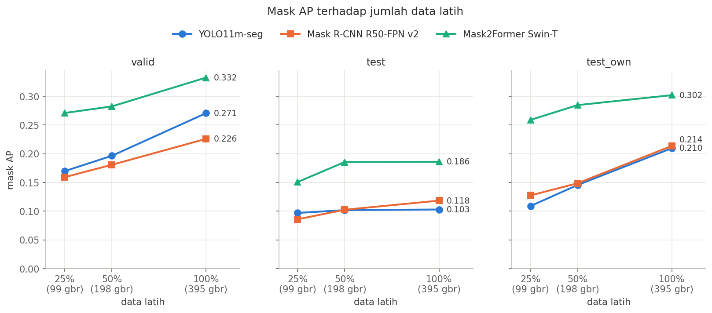
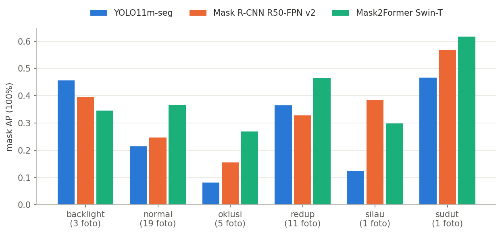

# Segmentasi Instance pada Lingkungan Indoor Nyata

Tugas Evaluasi CPMK 3, Mata Kuliah Visi Komputer (ITS). Perbandingan tiga model segmentasi instance dari dua keluarga arsitektur pada dataset **Panoptic Indoor Segmentation v5** (Roboflow, 74 kelas), dengan **variabel wajib NRP (digit terakhir = 3): jumlah data latih 25% / 50% / 100%** (99 / 198 / 395 gambar, subset bertingkat `25% ⊂ 50% ⊂ 100%`, `seed = 42`), serta evaluasi pada **test set foto HP sendiri (`test_own`)**.

| Model | Keluarga Arsitektur | Epoch (100%) | Jam-GPU Train (3 fraksi) | Notebook |
|---|---|---:|---:|---|
| **YOLO11m-seg** | One-stage, CNN (anchor-free) | 150 | 1,93 jam | [`notebooks/01_yolo11_seg.ipynb`](notebooks/01_yolo11_seg.ipynb) |
| **Mask R-CNN R50-FPN v2** | Two-stage, CNN (RPN + RoIAlign) | 70 | 2,65 jam | [`notebooks/02_mask_rcnn.ipynb`](notebooks/02_mask_rcnn.ipynb) |
| **Mask2Former Swin-T** | Transformer (masked-attention queries) | 60 | 3,65 jam | [`notebooks/03_mask2former.ipynb`](notebooks/03_mask2former.ipynb) |

Seluruh model dievaluasi secara seragam menggunakan `pycocotools` (`seg_common.py` identik di NB 1–3): **Mask AP = mAP@[.50:.95] COCO**, area dihitung dari mask, `maxDets = 100`, skor minimum `0,001`.

---

## Ringkasan Hasil Utama

### 1. Pengaruh Jumlah Data Latih (25% / 50% / 100%): Mask AP (`mAP@[.50:.95]`)

| Model | `valid` (25% / 50% / 100%) | `test` (25% / 50% / 100%) | `test_own` (25% / 50% / 100%) | Kenaikan 25→100% (`test_own`) |
|---|---:|---:|---:|---:|
| **YOLO11m-seg** | 0,170 / 0,196 / 0,271 | 0,097 / 0,102 / 0,103 | 0,109 / 0,146 / **0,210** | **+92,5%** |
| **Mask R-CNN R50-FPN v2** | 0,159 / 0,181 / 0,226 | 0,086 / 0,102 / 0,118 | 0,127 / 0,149 / **0,214** | **+67,7%** |
| **Mask2Former Swin-T** | 0,271 / 0,282 / **0,332** | 0,151 / 0,186 / **0,186** | 0,259 / 0,285 / **0,302** | **+16,6%** |



### 2. Domain Shift (`valid` → `test` → `test_own`, fraksi 100%)

| Model | AP `valid` | AP `test` | AP `test_own` | Sisa `test/valid` | Sisa `test_own/valid` |
|---|---:|---:|---:|---:|---:|
| **YOLO11m-seg** | 0,271 | 0,103 | 0,210 | 38,0% | 77,5% |
| **Mask R-CNN R50-FPN v2** | 0,226 | 0,118 | 0,214 | 52,4% | **94,6%** |
| **Mask2Former Swin-T** | **0,332** | **0,186** | **0,302** | **55,9%** | 90,8% |

### 3. Evaluasi Kondisi Sulit pada `test_own` (40 foto HP, 276 poligon, 35 kelas)

| Kondisi | Foto | Instance | YOLO11m-seg (AP / F1) | Mask R-CNN (AP / F1) | Mask2Former (AP / F1) |
|---|---:|---:|---:|---:|---:|
| `normal` | 19 | 130 | 0,214 / 0,367 | 0,247 / 0,366 | 0,367 / 0,497 |
| `redup` | 11 | 74 | 0,364 / 0,387 | 0,328 / 0,360 | 0,464 / 0,537 |
| `oklusi` | 5 | 36 | **0,082 / 0,076** | **0,155 / 0,168** | **0,269 / 0,245** |
| `backlight` | 3 | 26 | 0,457 / 0,481 | 0,394 / 0,541 | 0,346 / 0,414 |
| `silau` | 1 | 7 | 0,123 / 0,267 | 0,386 / 0,462 | 0,298 / 0,600 |
| `sudut` | 1 | 3 | 0,467 / 0,286 | 0,567 / 0,667 | 0,617 / 0,667 |



### 4. Ringkasan 5 Studi Kasus Kegagalan (`test_own`) & Eksperimen Pembuktian Kecil

Dijalankan langsung pada bobot 100% di [`notebooks/05_demo_dan_studi_kasus.ipynb`](notebooks/05_demo_dan_studi_kasus.ipynb) (output: [`hasil/5/cv-is-demo.ipynb`](hasil/5/cv-is-demo.ipynb)):

| Kasus | Foto `test_own` | Eksperimen Pembuktian | YOLO (F1) | Mask R-CNN (F1) | Mask2Former (F1) | Bukti / Kesimpulan |
|---|---|---|---:|---:|---:|---|
| **1. Oklusi berat & kelas langka** | `oklusi_03` (5 `towel`, 2 `bottle`) | (a) `conf 0.25→0.05`, NMS `0.7→0.9`<br>(b) Crop/Zoom | 0,000 → 0,000<br>0,000 → 0,000 | 0,100 → 0,047<br>0,100 → 0,080 | 0,000 → 0,000<br>0,000 → 0,000 | TP tidak naik, FP melonjak → kegagalan murni representasi kelas langka (`towel`, 14 di train) teroklusi, bukan threshold/skala. |
| **2. Kelas *unseen* vs objek kecil** | `normal_14` (`toothbrush*`, `spoon`, `fork`) | Crop/Zoom ketat objek kecil | **0,000 → 0,222** | 0,125 → 0,000 | **0,182 → 0,333** | `spoon` mulai terdeteksi saat diperbesar, tetapi **`toothbrush` (0 di train) tetap 0 di semua model** → memisahkan efek skala vs closed-set. |
| **3. Adegan padat bertumpuk** | `oklusi_04` (13 objek rak) | Resolusi inferensi `640 → 960` | **0,200 → 0,235** | **0,062 → 0,100** | **0,000 → 0,133** | Ketiga model serempak naik F1 → membuktikan batas resolusi input 640 px pada adegan padat. |
| **4. Cahaya redup** | `redup_07` (vs pasangan `oklusi_01`) | Pencerahan `gamma 0.55 + CLAHE` | **0,000 → 0,400** | **0,000 → 0,250** | 0,500 → 0,400 | Kedua CNN langsung pulih dari TP `0→2`; Mask2Former sudah tahan gelap sejak awal (TP tetap 2). |
| **5. Silau / pantulan kuat** | `silau_01` (vs pasangan `normal_10`) | Kompresi highlight `gamma 1.35 + CLAHE` | 0,267 → 0,143 | 0,444 → 0,429 | **0,429 → 0,462** | Mask2Former membaik (FP `4→3`), tetapi piksel jenuh (*clipped highlights*) tidak dapat dipulihkan pascaproses sederhana pada CNN. |

---

## Dokumen Pendukung & Bukti Proses

- [`PANDUAN_DEMO.md`](PANDUAN_DEMO.md): Penjelasan lengkap tugas dari deskripsi hingga kesimpulan + panduan demo langsung 10 menit.
- [`LOGBOOK.md`](LOGBOOK.md): Hipotesis bertanggal (H1–H3), kronologi proses, rekap waktu GPU (~9,37 jam-GPU total), kendala & keputusan, riwayat commit.
- [`DEKLARASI_AI.md`](DEKLARASI_AI.md): Deklarasi transparan penggunaan AI, prompt utama, dan 5 kasus nyata saran/kode AI yang salah beserta perbaikannya.
- [`test own/exif_test_own.csv`](test%20own/exif_test_own.csv) & [`test own/daftar_objek.md`](test%20own/daftar_objek.md): Bukti EXIF (tanpa GPS) dan daftar lengkap 276 anotasi `test_own`.

## Struktur Repositori

```
notebooks/
  00_data_prep.ipynb            unduh Roboflow, bersihkan anotasi, subset 25/50/100%, konversi COCO->YOLO, test_own
  01_yolo11_seg.ipynb           training 3 fraksi (150 ep) + evaluasi seragam (Ultralytics)
  02_mask_rcnn.ipynb            training 3 fraksi (70 ep) + evaluasi seragam (torchvision)
  03_mask2former.ipynb          training 3 fraksi (60 ep) + evaluasi seragam (transformers)
  04_perbandingan.ipynb         perbandingan 3 model, domain shift, kondisi sulit, galeri kegagalan (CPU)
  05_demo_dan_studi_kasus.ipynb demo langsung 10 menit + eksperimen 5 studi kasus kegagalan (GPU T4)
hasil/
  0..5/                         salinan notebook hasil run Kaggle (dengan output), log training asli (results.csv,
                                train_summary.json, gpu_time_log.csv), serta tabel CSV & grafik PNG di hasil/4/results-2/
test own/
  test/                         ekspor Roboflow test_own (40 foto 639x480 + _annotations.coco.json)
  exif_test_own.csv             tabel EXIF + pemetaan nama asli -> nama kondisi
  daftar_objek.md               daftar anotasi per foto dan per kelas
LOGBOOK.md                      logbook eksperimen, hipotesis bertanggal, waktu GPU
DEKLARASI_AI.md                 deklarasi penggunaan AI + 5 kasus kesalahan AI
PANDUAN_DEMO.md                 ringkasan lengkap proyek & panduan bacaan persiapan demo 10 menit
```

## Urutan Menjalankan di Kaggle

1. **Notebook 0** (CPU, Internet On, Secret `ROBOFLOW_API_KEY`) → menghasilkan `indoor_seg_data.zip`.
2. **Notebook 1–3** (GPU T4 ×2, Add Input: output NB 0) → pilot (`PILOT = True`), lalu training penuh (`PILOT = False, RUN_TRAINING = True`), atau prediksi ulang setelah ada `test_own` (`RUN_TRAINING = False`).
3. **Notebook 4** (CPU, Add Input: output NB 0–3 versi terbaru) → seluruh tabel & grafik perbandingan.
4. **Notebook 5** (GPU T4, Add Input: output NB 0–3 versi terbaru) → demo inferensi langsung & 5 eksperimen studi kasus.
